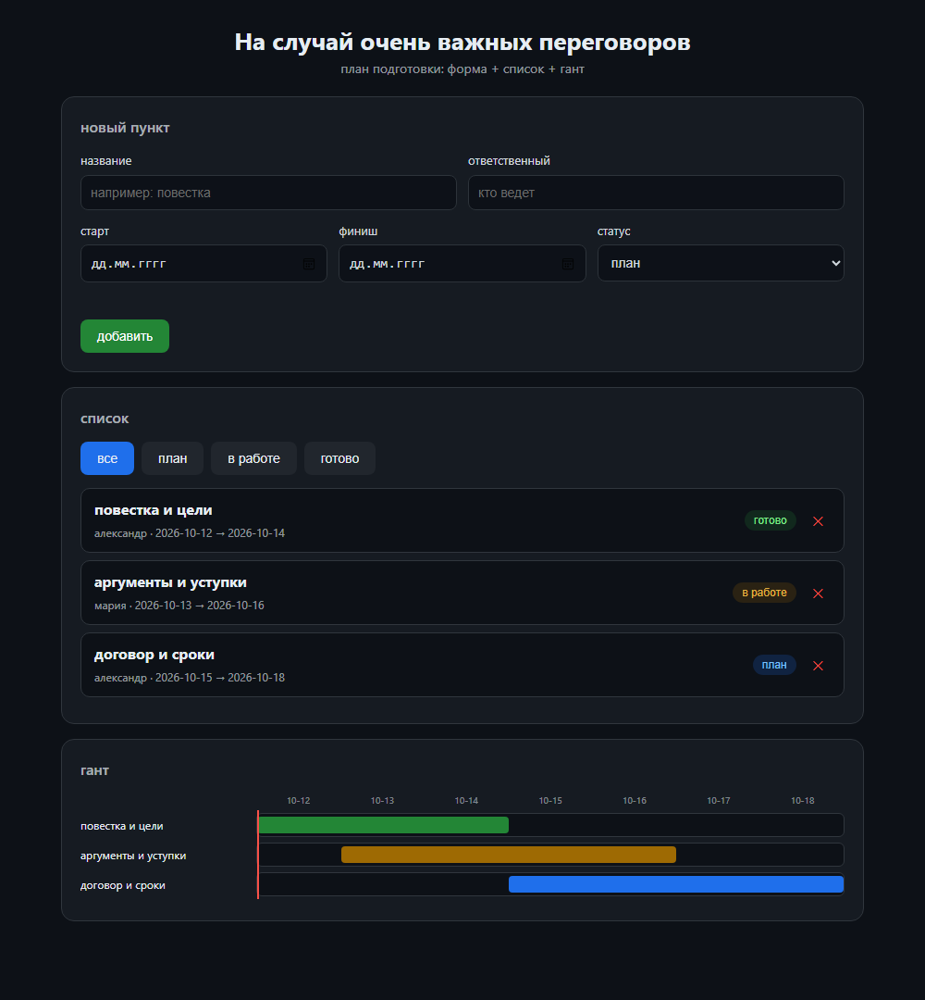

# w1-peregovory-gantt — планер переговоров

Проект 1 из web-серии: форма + динамический список + диаграмма Ганта.
Ванилла: HTML + CSS + JS без библиотек, открывается двойным кликом.

## что умеет

- форма: название, ответственный, старт/финиш, статус; валидация с подсветкой
- список: смена статуса кликом, удаление, фильтр, хранение в localStorage
- гант: шкала по дням, полосы по статусам, метка сегодня

## запуск

открыть `index.html` в браузере. зависимостей нет.

## проверка логики

`node A:\TEMP\w1_check.js` — `logic ok` (валидация, позиции полос, статусы).

## скрин

